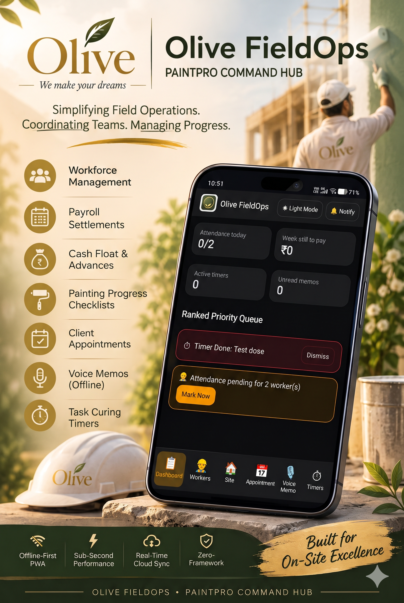
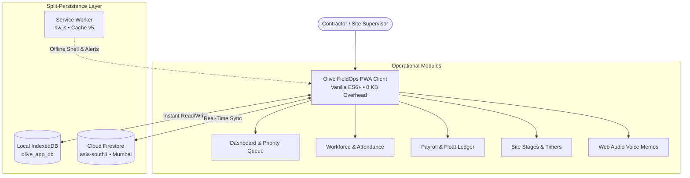

<div align="center">

  # Olive FieldOps — PaintPro Command Hub
  
  **A zero-framework, offline-first Progressive Web App (PWA) for field workforce coordination, payroll settlements, cash float tracking, and site progress management.**

  <p>
    
    
    
    
    
  </p>

  <p>
    <a href="https://blessonbiju2006.github.io/Olive-FieldOps/"><strong>Live Application</strong></a> •
    <a href="#-system-architecture"><strong>Architecture</strong></a> •
    <a href="#-dual-storage-engine"><strong>Storage Engine</strong></a> •
    <a href="#-local-setup--deployment"><strong>Setup Guide</strong></a>
  </p>

  <br />

  

</div>

---

## Overview

**Olive FieldOps (PaintPro Command Hub)** is a mobile-first field operations system built for painting contractors, site supervisors, and turnkey interior execution teams. Designed to operate reliably inside low-connectivity construction sites, it unifies attendance tracking, wage rate ledgers, cash advance floats, drying timers, and voice field notes into an instant-loading web application.

By eliminating heavy frontend frameworks and server runtimes, the application achieves **0 KB framework overhead**, sub-second cold boot speeds, and **₹0/month infrastructure costs**.

---

## Core Capabilities

| Module | Operational Capabilities |
| :--- | :--- |
| **Command Dashboard & Priority Queue** | Real-time operational counters (daily attendance, weekly payable balance, active timers, unread memos) paired with a ranked priority queue for immediate supervisor action. |
| **Workforce & Attendance Ledger** | Daily attendance toggling, historical daily wage rate tracking per worker, pending attendance alerts, and safe removal controls. |
| **Payroll & Cash Float Accounting** | Automated weekly net payout calculations in Indian Rupees (`₹`), cash advance (float) disbursements with full reversal audit trails, and week settlement locking. |
| **Site Progress & Drying Timers** | Room-by-room stage checklists (*Sanding*, *Primer*, *Finish Coat*) integrated with background Service Worker countdown timers for paint curing cycles. |
| **Offline Web Audio Voice Memos** | Native browser audio capture for on-site supervisor notes, persisted locally as binary blobs to conserve cellular data and cloud quotas. |
| **Client Appointments** | Structured site visit cards featuring one-tap native phone call triggers and direct WhatsApp launch links. |
| **Adaptive Field UI** | Installable home-screen PWA with high-contrast Dark and Light themes engineered for readability under direct outdoor sunlight. |

---

## System Architecture

Olive FieldOps follows a **Local-First, Serverless BaaS (Backend-as-a-Service)** topology. The client browser executes all business logic and UI rendering locally, while a background Service Worker manages asset caching and a split-persistence layer coordinates offline resilience with cloud synchronization.



### Technology Stack

| Layer | Technology | Role in System |
| :--- | :--- | :--- |
| **Client Runtime** | Vanilla JavaScript (ES6+), HTML5, Modular CSS3 | Zero-dependency state machine and native DOM rendering |
| **PWA & Offline Proxy** | Service Worker (`sw.js`), `manifest.webmanifest` | Offline asset caching, version invalidation, and timer notifications |
| **Local Edge Database** | Browser IndexedDB (`olive_app_db`) | Primary offline state store and binary audio blob persistence |
| **Cloud Sync Engine** | Google Firebase Firestore (SDK v8 Compat) | Multi-device real-time state synchronization (`asia-south1`) |
| **CDN & Hosting** | GitHub Pages | Static global delivery over HTTPS |

---

## Dual-Storage Engine

To maintain 100% offline reliability on job sites while keeping cloud database operations within free-tier quotas, persistence is partitioned by data weight and sync requirements:

| Data Entity | Local IndexedDB (`olive_app_db`) | Cloud Firestore (`olive_hub/main_hub`) | Sync Behavior |
| :--- | :--- | :--- | :--- |
| **Worker Profiles & Wage Rates** | Cached (`kv` store) | Synced | Real-time multi-device sync |
| **Daily Attendance & Floats** | Cached (`kv` store) | Synced | Real-time multi-device sync |
| **Job Sites, Stages & Timers** | Cached (`kv` store) | Synced | Real-time multi-device sync |
| **Client Appointments** | Cached (`kv` store) | Synced | Real-time multi-device sync |
| **Voice Memos (Audio Blobs)** | Persisted (`memos` store) | Excluded | Device-local binary storage (`0 KB` cloud bandwidth) |

---

## Repository Structure

```text
Olive-FieldOps/
├── assets/
│   ├── olive-app-hero.png       # Official PaintPro Command Hub promotional banner
│   ├── dashboard-preview.png    # Mobile dashboard interface capture
│   ├── workers-ledger.png       # Workforce attendance & cash float view
│   └── site-stages.png          # Room-by-room painting progress checklist
├── css/                         # Modular styling rules and Dark/Light theme variables
├── icons/                       # PWA launcher icons and platform splash assets
├── js/
│   └── app.js                   # Core state management, IndexedDB & Firestore handlers
├── index.html                   # Single-page application shell & view containers
├── manifest.webmanifest         # PWA installation metadata and display rules
├── sw.js                        # Service Worker cache controller & notification handler
└── README.md                    # System documentation
```

---

## Local Setup & Deployment

### 1. Run Locally
Because Olive FieldOps uses pure web standards with no build step, `Node.js` or `npm` installations are not required.

```bash
# Clone the repository
git clone https://github.com/blessonbiju2006/Olive-FieldOps.git
cd Olive-FieldOps

# Serve via local HTTP server (required for Service Worker registration)
python -m http.server 8000
```
Open `http://localhost:8000` in your browser.

### 2. PWA Cache Maintenance & Release Workflow

<details>
<summary><strong>Click to expand Service Worker cache invalidation steps</strong></summary>
<br />

When deploying code or UI updates to installed mobile devices, increment the cache version in `sw.js` so clients fetch fresh assets:

1. Open `sw.js` and bump `CACHE_NAME`:
   ```javascript
   const CACHE_NAME = 'olive-app-v6'; // Increment version (e.g., v5 -> v6)
   ```
2. Commit and push to GitHub Pages:
   ```bash
   git add .
   git commit -m "chore: bump service worker cache to v6"
   git push origin main
   ```

</details>

<details>
<summary><strong>Click to expand Firebase Security & Configuration notes</strong></summary>
<br />

- **Firestore Region:** `asia-south1` (Mumbai) for low-latency South India access.
- **Document Node:** `olive_hub/main_hub`.
- **Production Hardening:** Restrict API key HTTP referrers to `https://blessonbiju2006.github.io/*` in Google Cloud Console and enforce strict Firestore Security Rules before handling live payroll records.

</details>

---

## Architecture Economics

- **Infrastructure Operating Cost:** **₹0 / month** — Powered by GitHub Pages static hosting and Google Firebase Spark free tier (50,000 daily reads / 20,000 daily writes) via local binary audio isolation.
- **Commercial Package Valuation:** **₹45,000 – ₹60,000** standard custom deployment value with an **~₹8,000 / year** maintenance retainer benchmark.

---

<div align="center">

  **Olive FieldOps — PaintPro Command Hub**  
  Engineered for **Olive** *(Interior Design, Turnkey Solutions & Painting Services • Kerala, India)*  
  *We make your dreams*

</div>